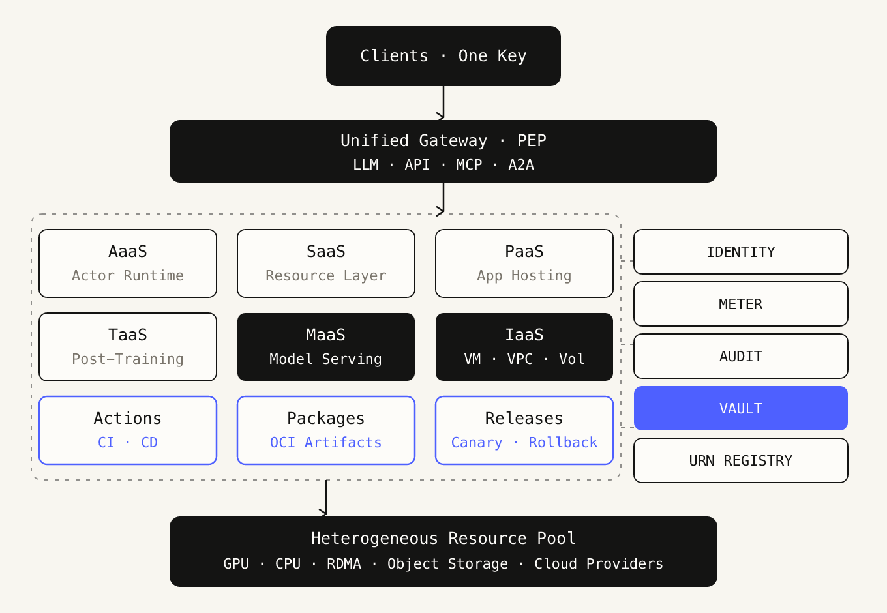
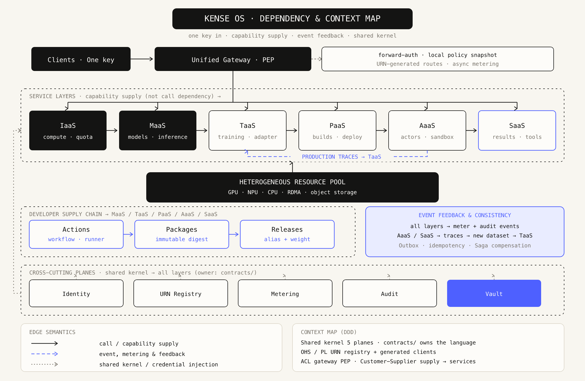
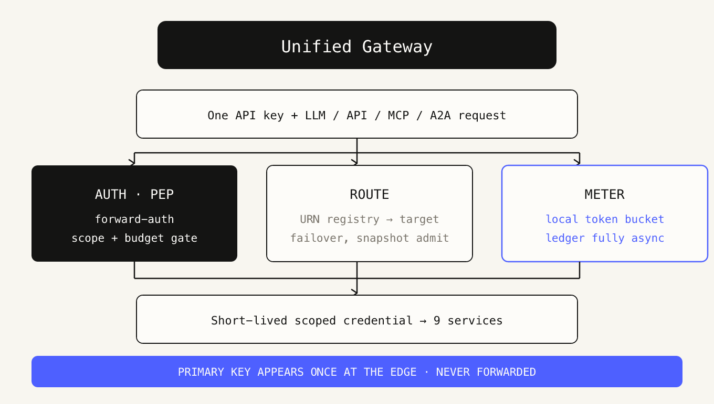
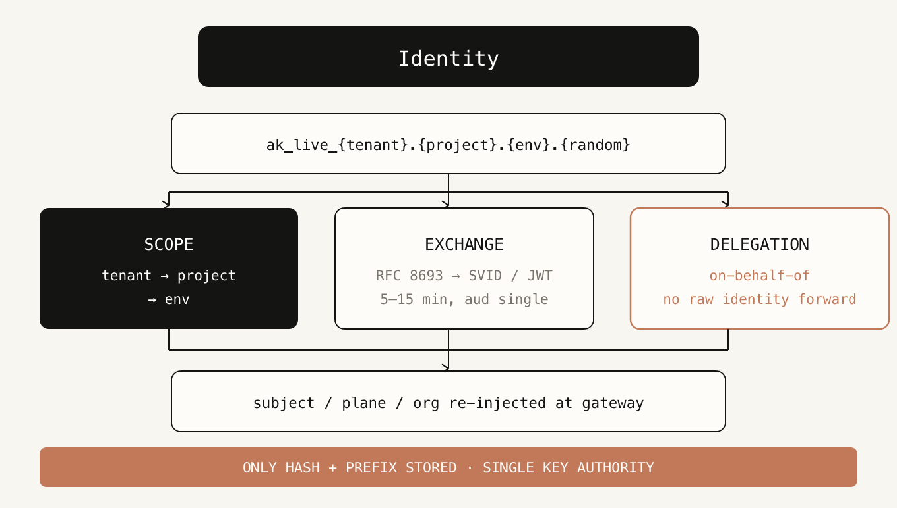
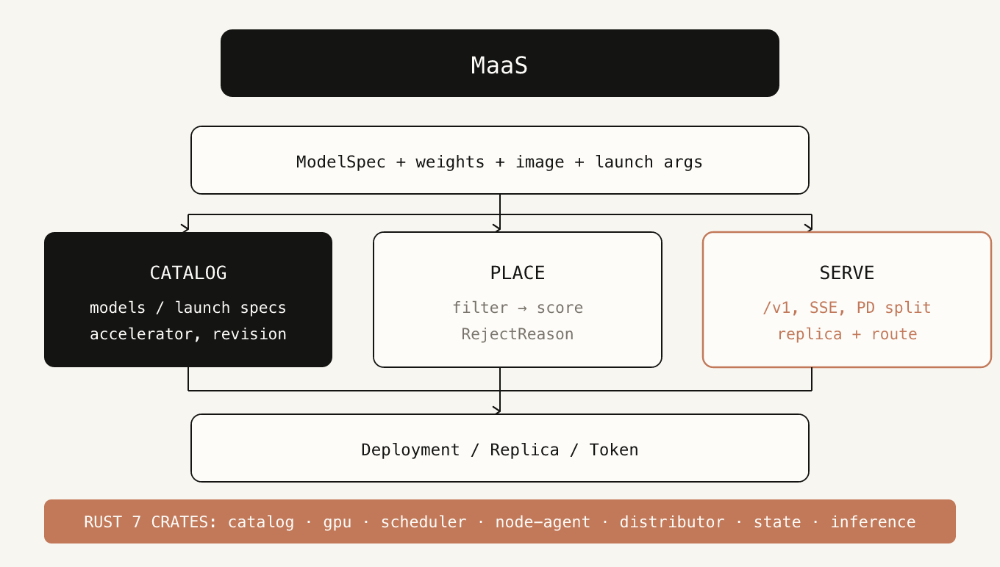
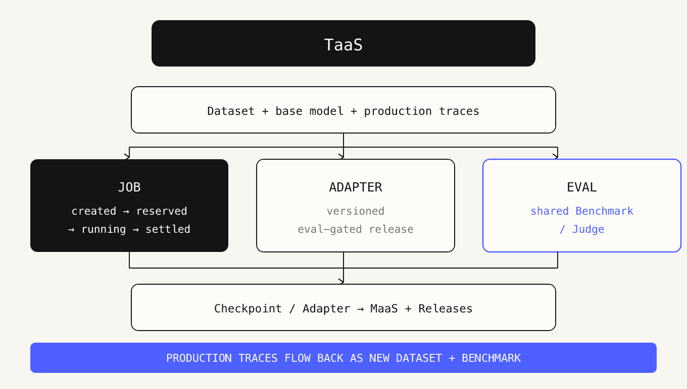
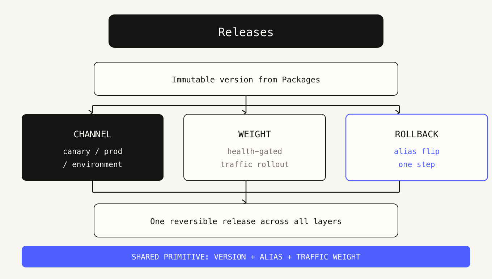

# Kense

**AI OS.** One API key for heterogeneous compute, models, agents, apps and data capabilities.

Kense is an operating plane, not an AI application framework. It owns placement, isolation, routing, metering, audit and release; inference stays in the engines and workloads stay in their sandboxes.

English | [简体中文](README.zh-CN.md)

## Architecture

[Vector source](docs/ai-os-architecture.svg)

The supply side feeds the product side: `IaaS → MaaS → TaaS → PaaS / AaaS → SaaS`. Actions, Packages and Releases cut across every layer and ship changes through one primitive — **immutable version → alias → traffic weight** — so rollout and rollback work the same way everywhere.

One credential, one chain. The primary key is presented once at the gateway and exchanged for a short-lived scoped credential; downstream services never see it and sandboxes hold none. Capabilities register as URNs before exposure, and every request emits one metered event, so identity, quota, budget, audit and billing share a single chain.

## Dependencies & context map

[Vector source](docs/kense-os-context-map.svg)

Three edge types: solid ink for calls and capability supply, dashed clay for events, metering and feedback, dotted grey for the shared kernel and credential injection. The orange loop closes the chain that individual module diagrams leave open — production traces from AaaS / SaaS return as a new dataset and benchmark for TaaS. Metering and audit events flow from every layer, so no event source is left dangling.

In DDD terms the five planes are a shared kernel owned by `contracts/`; the URN registry is an Open Host Service whose Published Language is the generated clients; the gateway is the Anti-Corruption Layer at the edge; the supply chain is a Customer-Supplier of the service layers; the resource pool is Conformist to the control plane's placement declarations.

## Module architecture

Vector sources for every diagram live in [`docs/modules/svg/`](docs/modules/svg/).

### Access & control

The promise of one key: the edge admits the request and exchanges trust, while five shared models decide whether quota, routing, billing, audit and credentials can all hang off a single chain.

#### Unified Gateway

The single entry point and policy enforcement point. Routes LLM, API, MCP and A2A traffic, applies rate limits and failure fallback, and re-injects `subject / plane / org` through forward-auth. The primary key appears here once and is never forwarded; when the control plane is unavailable the gateway keeps serving from its last policy snapshot.

**Metering** `requests / rate limits` · **Invariant** `PRIMARY KEY APPEARS ONCE AT THE EDGE · NEVER FORWARDED`

#### Identity

The single authority for the API key. Only an HMAC / argon2id hash and a prefix are stored. A `tenant → project → env` scope decides billing, quota and release boundaries; RFC 8693 exchange issues 5–15 minute, single-audience SVID / JWT tokens. Delegation is always on-behalf-of — raw identity is never forwarded.

**Metering** `— (trust root)` · **Invariant** `ONLY HASH + PREFIX STORED · SINGLE KEY AUTHORITY`

#### URN Registry

Every capability is registered before it is exposed. Registration declares protocol, metering unit, quota dimension, SLO, scope and audit level. The gateway generates routes, SDKs and the OpenAPI snapshot from the registry, so nine services do not each implement their own authorization.

**Metering** `— (directory)` · **Invariant** `REGISTER BEFORE EXPOSE · ONE AUTH PATH FOR ALL SERVICES`

#### Metering

Each request produces exactly one meter event carrying `event_id / trace_id / billing_parent`. Long jobs pre-hold budget, renew on heartbeat and settle at completion. The billing path is fully asynchronous, and the commercial ledger is architecturally forbidden from joining the usage ledger directly.

**Metering** `credit (versioned rate table)` · **Invariant** `BILLING LEDGER AND USAGE LEDGER NEVER JOIN DIRECTLY`

#### Audit

An append-only hash chain per tenant, whose head is periodically anchored externally. Sensitive actions are logged before they execute. The auditor role is mutually exclusive with admin, and querying the audit log itself emits an event. Covers seven event classes from authentication to administrative actions.

**Metering** `— (compliance)` · **Invariant** `AUDITOR ROLE IS MUTUALLY EXCLUSIVE WITH ADMIN`

#### Vault

Third-party credentials live here; the primary key never does. Scope is `(org, project, env)`. `materialize` seals ciphertext, `apply` activates it for a scope × provider pair, and `revoke` is terminal — every step emits a receipt into the audit chain. Egress injects only `secret_ref + version`, never plaintext.

**Metering** `— (secrets)` · **Invariant** `PLAINTEXT NEVER ENTERS SANDBOX, LOGS, WIRE OR AUDIT`

### Service layers (supply chain)

IaaS to MaaS to TaaS to PaaS / AaaS to SaaS. Lower layers supply capability upward; upper layers report production data back down.

#### IaaS

Owns heterogeneous accelerator facts, quotas and node leases. Node agents dial out (zero inbound), heartbeat and report device facts. Exposes VM / VPC / Volume / Image / Snapshot with tenant VPC isolation and long lifetimes.

**Metering** `vCPU·h / GPU·h / GB·month / egress GB` · **Invariant** `TENANT VPC · LONG-LIVED · MINUTES TO MONTHS`

#### MaaS

Model catalog, artifact distribution, explainable placement and OpenAI-compatible inference. The Rust skeleton in `platform/` consists of seven crates — `catalog`, `gpu`, `scheduler`, `node-agent`, `distributor`, `state`, `inference` — while the serving layer reuses kpower's `/v1` and distributed serving.

**Metering** `input + output tokens / GPU·h / replica·s` · **Invariant** `RUST 7 CRATES: catalog · gpu · scheduler · node-agent · distributor · state · inference`

#### TaaS

Datasets, experiments, jobs, checkpoints, adapters and evaluation gates. Jobs move `created → reserved → running → settled`. A shared Benchmark / Judge serves both adapter promotion and online regression. Production traces and failure samples return as a new dataset and a new benchmark.

**Metering** `training tokens / GPU·s / evaluations` · **Invariant** `PRODUCTION TRACES FLOW BACK AS NEW DATASET + BENCHMARK`

#### PaaS

`Git → Build → Deploy → Rollback` with immutable artifacts and secrets from Vault. It uses the same version + alias + traffic-weight primitive as MaaS, TaaS and Releases, so rollback is an alias flip. Elastic 0→N per project or function.

**Metering** `build minutes / requests / GB·s / egress GB` · **Invariant** `ELASTIC 0→N · SECRETS FROM VAULT`

#### AaaS

Agent runtime: per-actor sandbox, sessions, tool calls, suspend / resume and checkpoints. Sandboxes hold no credentials — egress injects only `secret_ref + version`. Missing host capabilities fail closed rather than silently falling back to bare execution.

**Metering** `actor·s / wakeups / snapshot GB·day` · **Invariant** `SANDBOX HOLDS NO CREDENTIAL · ACTOR·SEC + WAKEUPS`

#### SaaS

Product surfaces built on the layers below. Unified tenant schema, stateless, exposed as Entity / Tool / Skill. Billing is outcome-gated: a request that produces no valid result is not charged.

**Metering** `per valid result; no result, no charge` · **Invariant** `BILL PER VALID RESULT · NO RESULT → NO CHARGE`

### Developer supply chain

Actions produces artifacts, Packages freezes immutable versions, Releases rolls out via aliases and traffic weights — feeding changes into the service chain and closing the training feedback loop.

#### Actions

Event-triggered workflows (push, PR, schedule, evaluation finished, training finished, alerts) with managed CPU and GPU runners. Secrets reuse the identity plane. Produces artifacts for Packages, triggers Releases, and can call TaaS for training or MaaS for evaluation.

**Metering** `runner·min / concurrency` · **Invariant** `CALLS TAAS FOR TRAINING · MAAS FOR EVALUATION`

#### Packages

An OCI / ORAS artifact registry for container images, model weights, LoRA adapters, datasets, agent bundles and MCP server packages. Versions are immutable, with attestation, SBOM, signature verification and namespace retention policies.

**Metering** `GB·month / pulls` · **Invariant** `RELEASES REFERENCE A CONCRETE DIGEST, NOT AN ALIAS`

#### Releases

Release / Channel (canary, prod) / Environment with traffic weights, health-gated rollout, one-step rollback and change records. Unifies adapter versions from MaaS, PaaS deployments and AaaS actor templates into a single reversible release.

**Metering** `releases / canary traffic` · **Invariant** `SHARED PRIMITIVE: VERSION + ALIAS + TRAFFIC WEIGHT`

### Resource substrate

The heterogeneous compute substrate accepts scheduling declarations only. The control plane declares intent; the pool enforces facts.

#### Heterogeneous Resource Pool

The heterogeneous compute substrate: NVIDIA, AMD, Ascend, PPU, Hygon, Apple and cloud providers. Device facts and memory, CPU / RDMA host networking, object storage and an image / weight cache. The control plane declares placement; the pool enforces facts and is never exposed directly to tenants.

**Metering** `metered through IaaS` · **Invariant** `CONTROL PLANE DECLARES · POOL ENFORCES · NO DIRECT TENANT ACCESS`

## Start here

- **Get a build** — product distributions ship from [Releases](https://github.com/kense-labs/kense/releases/latest).
- **Find the source** — public repositories are listed below; the backend source migrated out of aster lives in [`platform/`](platform/).
- **Read the contract** — the architecture diagram above is the canonical shape of the system.
- **Read the design review** — architecture analysis and project naming plan in [`docs/naming/`](docs/naming/).

## Repositories

| Repository | What it is |
| --- | --- |
| [ksandbox](https://github.com/kense-labs/ksandbox) | Rust-native, fail-closed process sandbox for agent tool calls |
| [dsh-acp](https://github.com/kense-labs/dsh-acp) | ACP-only DeepSeek Harness distribution; public container image |
| [dsh-gpui](https://github.com/kense-labs/dsh-gpui) | Desktop GPUI client for DeepSeek Harness |
| [KUI](https://github.com/kense-labs/KUI) | Rust UI kit for GPUI, native desktop and WASM web |
| [kense-labs.github.io](https://github.com/kense-labs/kense-labs.github.io) | Organization website |

## Boundaries

No prompt registry, hosted vector store, standalone LLMOps product, visual orchestrator or marketplace. Those are applications, not operating-system primitives.

## License

[MIT](LICENSE). Each component repository carries its own license.
