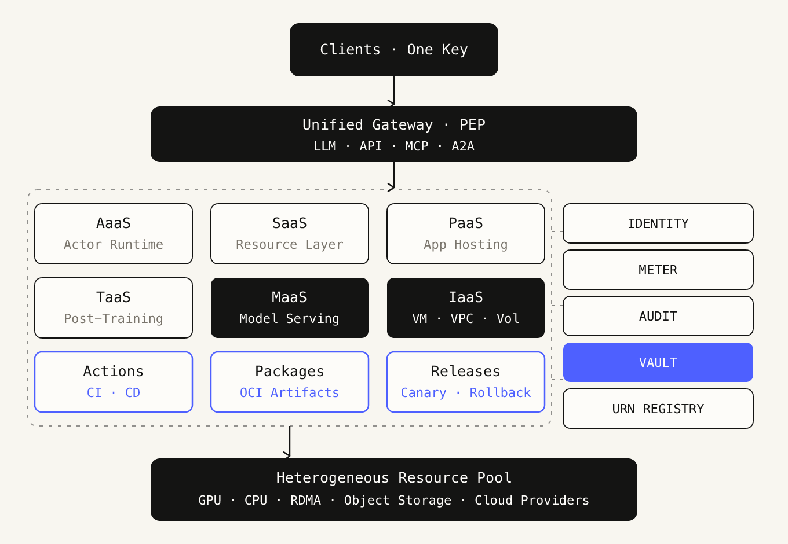
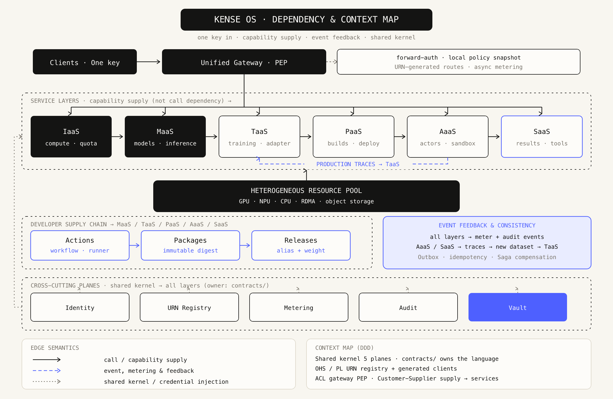
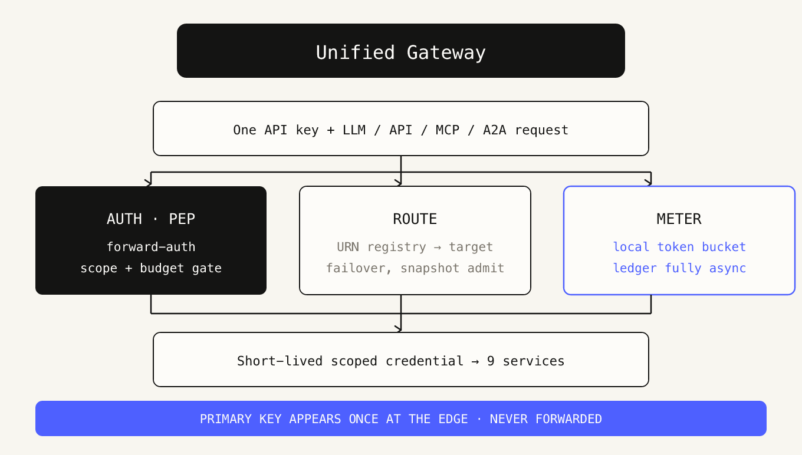
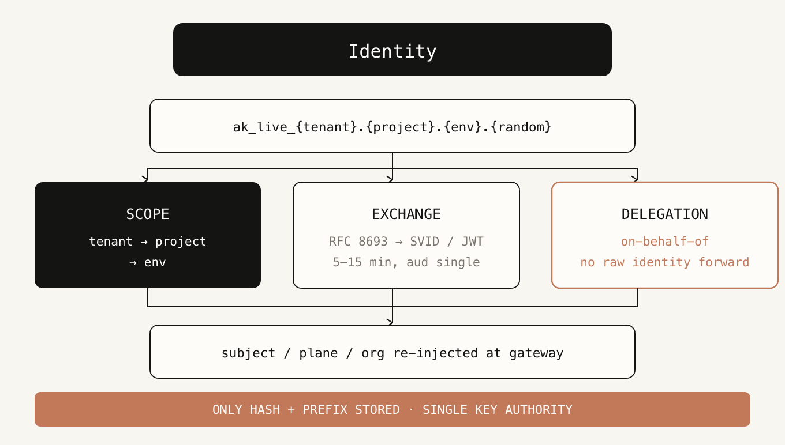
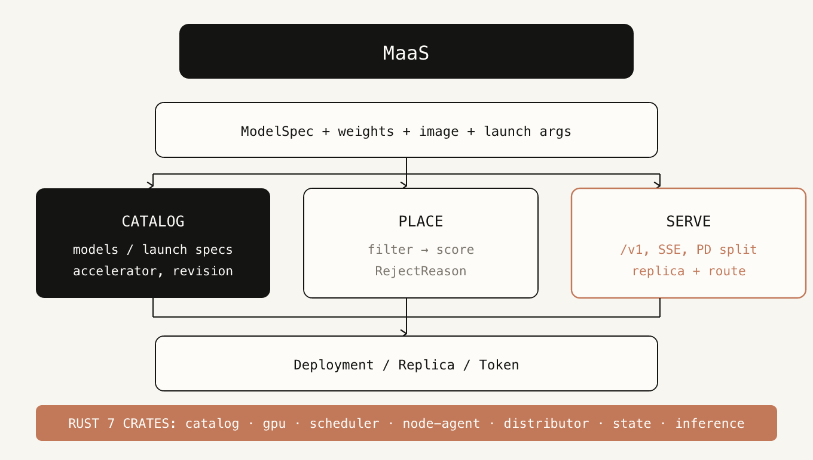
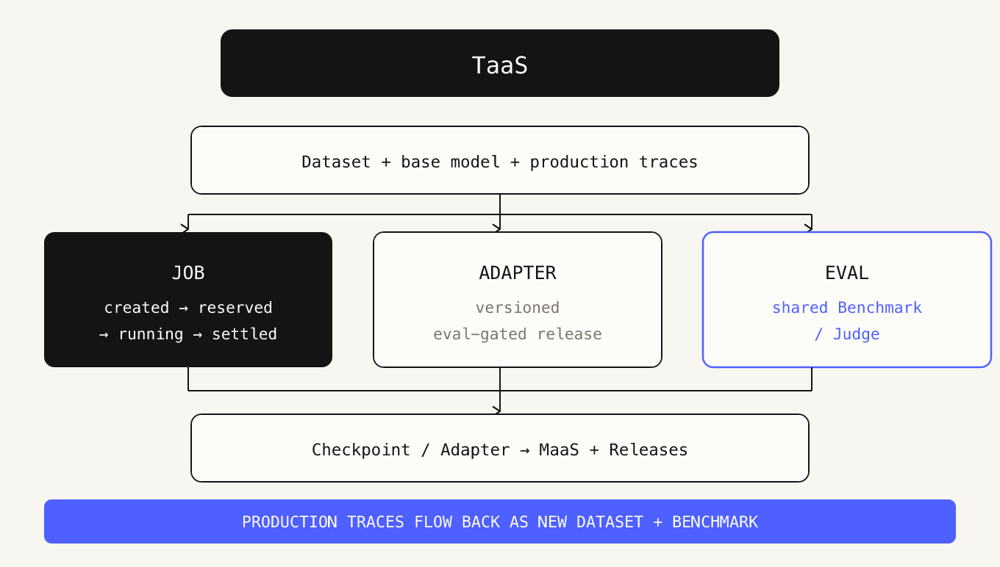
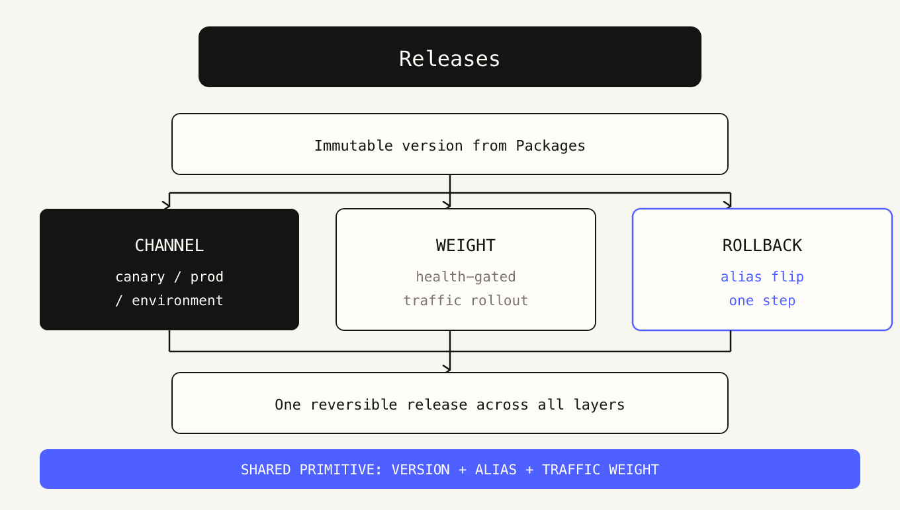

# Kense

**AI OS。** 一把 API Key 打通异构算力、模型、智能体、应用与数据能力。

Kense 是 AI 工作负载的供给与治理平面，不是 AI 应用开发框架：它负责放置、隔离、路由、计量、审计与发布；推理留在引擎里，工作负载留在沙箱里。

[English](README.md) | 简体中文

## 总体架构

[矢量源文件](docs/ai-os-architecture.svg)

供给侧向产品侧供能：`IaaS → MaaS → TaaS → PaaS / AaaS → SaaS`。Actions、Packages、Releases 横切所有层，用同一套原语交付变更——**不可变版本 → 别名 → 流量权重**——因此上线与回滚在各层语义一致。

一把 Key，一条链。主 Key 只在网关出示一次并换成短时限域凭据；下游服务看不到它，沙箱不持有任何凭据。能力在暴露前先注册为 URN，每次请求产生唯一计量事件，因此身份、配额、预算、审计与账单共用一条链。

## 依赖关系与上下文映射

[矢量源文件](docs/kense-os-context-map.svg)

三种边语义：墨黑实线表示调用与能力供给，陶土橙虚线表示事件、计量与反馈，灰色点线表示共享内核与凭据注入。橙色回流闭环补上了单张模块图里断开的那一段——AaaS / SaaS 的生产轨迹回流成新数据集与新 Benchmark 交给 TaaS；各层的计量与审计事件汇入 Metering / Audit，因此不再有悬空的事件源。

按 DDD 的语境：五个横切平面是由 `contracts/` 拥有的共享内核（Shared Kernel）；URN 目录是对外开放服务（Open Host Service），其 Published Language 就是生成的客户端；网关是边缘的防腐层（ACL）；供应链是服务层的客户—供应方（Customer-Supplier）；资源池对控制面的放置声明是遵从者（Conformist）。

## 模块架构

每张图的矢量源文件在 [`docs/modules/svg/`](docs/modules/svg/)。

### 接入与控制

一把 Key 的承诺闭环：入口做准入与信任交换，五个共享模型决定配额、路由、计费、审计与凭据能否共用一条链。

#### Unified Gateway · 统一网关

唯一入口与策略执行点。LLM / API / MCP / A2A 统一路由、限流、失败回退与快照准入；forward-auth 回注 subject / plane / org，主 Key 只在边缘出现一次。

**计量单位** `请求数 / 限流` · **关键约束** 主 Key 只在边缘出现一次，绝不向下游转发

#### Identity · 身份与 Key

一把 Key 的权威单点。库内只存 HMAC / argon2id 哈希与前缀；tenant → project → env 三层 Scope 决定计费、配额与发布边界；RFC 8693 换成 5–15 分钟、单服务 aud 的短时 SVID / JWT。

**计量单位** `—（信任根）` · **关键约束** 库内只存哈希与前缀，Key 权威单点

#### URN Registry · URN 服务目录

所有能力先注册再暴露。注册时声明协议、计量单位、配额维度、SLO、scope 与审计等级；网关据此生成路由、SDK 与 OpenAPI，避免九套服务各写一遍鉴权。

**计量单位** `—（目录）` · **关键约束** 先注册再暴露，九类服务共用一条鉴权路径

#### Metering · 计量与账单

每个请求产生唯一 meter 事件，带 event_id / trace_id / billing_parent；长任务预扣 → 心跳续扣 → 结束结算。账单链路完全异步，商业账本与 usage ledger 双轨且由架构测试强制不直连。

**计量单位** `credit（版本化汇率）` · **关键约束** 商业账本与 usage ledger 不得直连

#### Audit · 审计

每租户一条只追加哈希链，链头定期外部锚定。敏感动作先落审计再执行；审计员与管理员权限互斥，审计查询本身也产生事件。覆盖认证、授权、资源变更、数据访问、Agent 行为、计费预算、管理动作七类。

**计量单位** `—（合规）` · **关键约束** 审计员与管理员角色互斥

#### Vault · Vault 凭据

第三方凭据由 Vault 保管，主 Key 只存哈希。Scope = (org, project, env)；materialize 封存密文 → apply 按 scope × provider 激活 → revoke 终态，每步产生 receipt 并写入审计链。

**计量单位** `—（凭据）` · **关键约束** 明文不进沙箱、日志、wire 与审计

### 服务层（供给侧依赖链）

IaaS → MaaS → TaaS → PaaS / AaaS → SaaS。下层向上层提供能力，上层向下层回报生产数据。

#### IaaS · 基础设施

异构加速卡事实与配额的持有者。节点 agent 零入站外连、心跳与租约上报事实；对外提供 VM / VPC / Volume / Image / Snapshot，租户 VPC 隔离、长生命周期。

**计量单位** `vCPU·h / GPU·h / GB·月 / 出网 GB` · **关键约束** 租户 VPC 隔离，长生命周期，分钟到月

#### MaaS · 模型服务

模型目录、制品分发、可解释放置与 OpenAI 兼容推理。platform 的 Rust 骨架由 catalog / gpu / scheduler / node-agent / distributor / state / inference 七个 crate 组成，推理层复用 kpower 的 /v1 与分布式服务。

**计量单位** `输入/输出 token / 卡时 / 副本·秒` · **关键约束** Rust 骨架七个 crate：catalog / gpu / scheduler / node-agent / distributor / state / inference

#### TaaS · 训练与评测

数据集、实验、Job、checkpoint、adapter 与评测门禁。Job 走 created → reserved → running → settled；评测与 Judge 复用同一套基准，供 adapter 上线与线上回归。生产轨迹与失败样本回流成新数据集与新 Benchmark。

**计量单位** `训练 token / GPU·秒 / 评测次数` · **关键约束** 生产轨迹回流为新数据集与新 Benchmark

#### PaaS · 应用托管

Git → Build → Deploy → Rollback，产物不可变、Secrets 来自 Vault。发布使用与 MaaS / TaaS / Releases 共享的「版本 + 别名 + 流量权重」原语，回滚即别名翻转。项目 / 函数级弹性 0→N。

**计量单位** `构建分钟 / 请求数 / GB·s / 出网 GB` · **关键约束** 弹性 0→N，Secrets 来自 Vault

#### AaaS · 智能体运行时

Agent 运行时：单 actor 沙箱、会话、工具调用、挂起唤醒与检查点。沙箱零凭据，egress 网关只注入 secret_ref + version；沙箱 fail-closed，缺失宿主能力时拒绝降级为裸执行。

**计量单位** `actor·秒 / 唤醒次数 / 快照 GB·天` · **关键约束** 沙箱零凭据；按 actor·秒、唤醒次数、快照 GB·天 计量

#### SaaS · 产品层

构建在下面各层之上的产品表面。统一租户 schema、无状态，对外抽象为 Entity / Tool / Skill；按有效结果计费，无结果不产生账单。

**计量单位** `按有效结果条数；无结果不收费` · **关键约束** 按有效结果计费，无结果不收费

### 开发者供应链

Actions 产出制品 → Packages 固化不可变版本 → Releases 用别名与流量权重灰度，把变更送进服务链并形成训练回流闭环。

#### Actions · 工作流

事件触发的 Workflow（push / PR / schedule / 评测完成 / 训练完成 / 告警），托管 CPU 与 GPU 两种 Runner，Secrets 复用身份平面。产出构建产物给 Packages、触发 Releases，并可调用 TaaS 训练、MaaS 评测。

**计量单位** `runner·分钟 / 并发数` · **关键约束** 可调用 TaaS 训练、MaaS 评测

#### Packages · 制品仓库

OCI / ORAS 制品仓库：容器镜像、模型权重、LoRA adapter、数据集、Agent bundle、MCP server 包。版本不可变，附 Attestation 与 SBOM、签名验签，按命名空间与保留策略治理。

**计量单位** `GB·月 / 拉取次数` · **关键约束** Releases 引用具体 digest，而非别名

#### Releases · 发布

Release / Channel（canary、prod）/ Environment。灰度比例、健康检查门禁、一键回滚、变更记录与审计；把 MaaS 的 adapter 版本、PaaS 部署、AaaS actor 模板统一成一次可回滚发布。

**计量单位** `发布次数 / 灰度流量` · **关键约束** 共享原语：不可变版本 + 别名 + 流量权重

### 资源底座

异构算力池只接受调度声明，不直接对租户暴露；控制面声明意图，资源池执行事实。

#### Heterogeneous Resource Pool · 异构资源池

异构算力底座：NVIDIA / AMD / Ascend / PPU / Hygon / Apple 与云厂商。GPU / NPU 设备事实与显存、CPU / RDMA 主机网络、对象存储与镜像缓存。控制面声明放置意图，资源池执行事实，不对租户直接暴露。

**计量单位** `容量由 IaaS 计量` · **关键约束** 控制面声明、资源池执行，不直接对租户暴露

## 从哪里开始

- **获取构建** — 产品发行物发布在 [Releases](https://github.com/kense-labs/kense/releases/latest)。
- **查找源码** — 公开仓库见下表；从 aster 迁出的后端源码在 [`platform/`](platform/)。
- **阅读契约** — 上方架构图是系统形态的权威描述。

## 相关仓库

| 仓库 | 说明 |
| --- | --- |
| [ksandbox](https://github.com/kense-labs/ksandbox) | Rust 原生、fail-closed 的 Agent 工具调用进程沙箱 |
| [dsh-acp](https://github.com/kense-labs/dsh-acp) | DeepSeek Harness 的 ACP 发行版，提供公开容器镜像 |
| [dsh-gpui](https://github.com/kense-labs/dsh-gpui) | DeepSeek Harness 的桌面 GPUI 客户端 |
| [KUI](https://github.com/kense-labs/KUI) | 面向 GPUI 的 Rust UI 套件，原生桌面与 WASM Web 同源 |
| [kense-labs.github.io](https://github.com/kense-labs/kense-labs.github.io) | 组织官网 |

## 边界

不提供 Prompt 注册表、托管向量库、独立 LLMOps 产品、可视化编排或市场。这些属于应用，不是操作系统原语。

## 许可协议

[MIT](LICENSE)。各组件仓库各自携带许可证。
