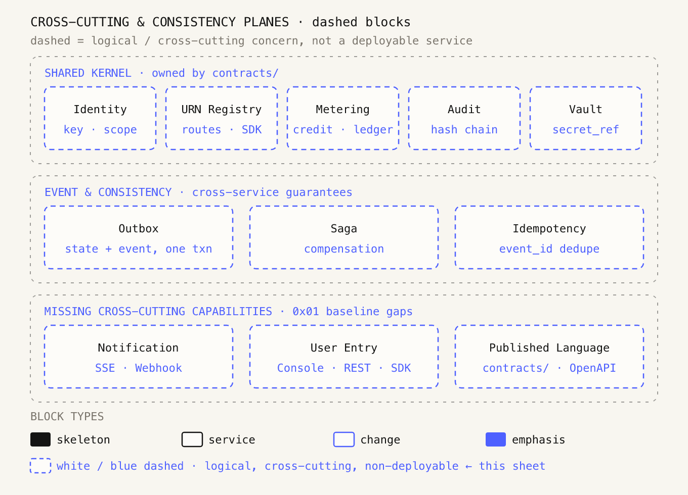
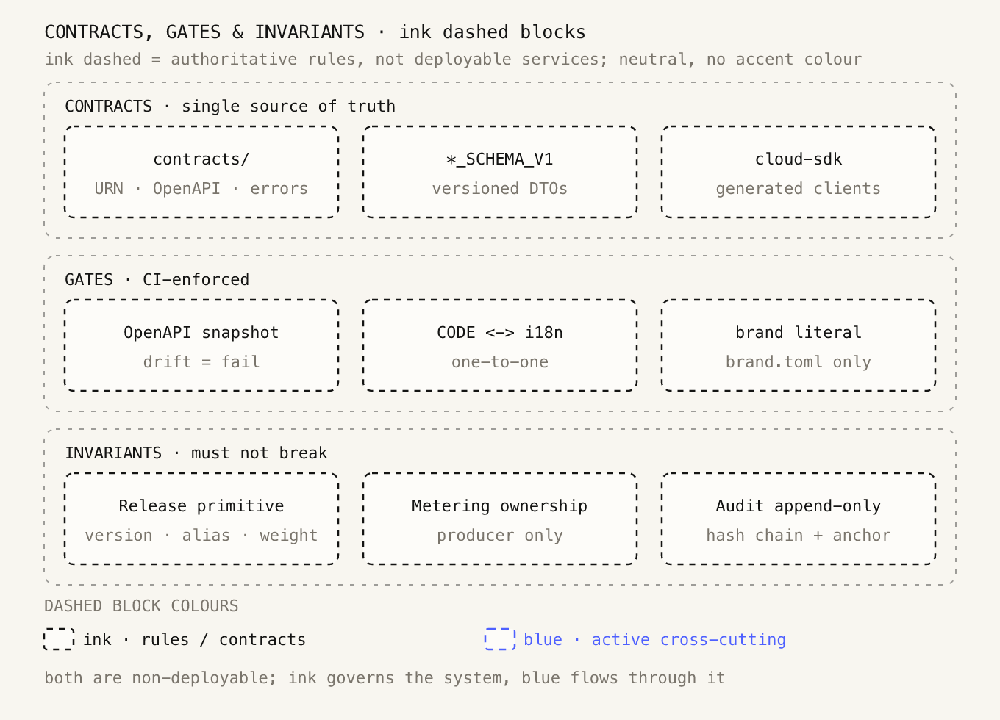
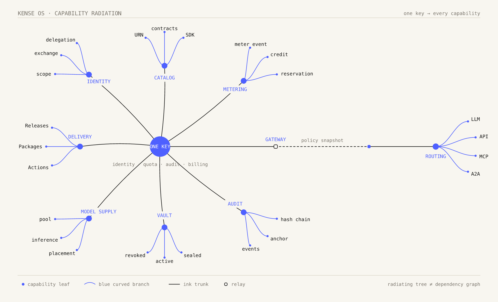

# 架构图制作规范

颜色承载语义，不承载审美。同一语义在任何一张图里用同一种视觉编码，不为平衡画面临时改。

## 色板

| 用途 | 值 |
| --- | --- |
| 纸底 | `#F8F6F0` |
| 墨黑（骨架 / 正文） | `#141413` |
| 点缀蓝 | `#4E60FF`，取自 kense `BRAND.md` 的 logo 蓝色点缀 |
| 白块 | `#FDFCF9` |
| 注释灰 | `#7A756C` |
| 浅蓝底（提示 / 事件框） | `#E9ECFF` |
| 分隔线 | `#DCD6C8` |

字体统一 Menlo 等宽；圆角 `rx` 6–9；直角折线；箭头是开放 V（`M2 1 L8 5 L2 9`，不闭合、不用实心三角）。

## 六种块型

| 类型 | 样式 | 语义 | 例子 |
| --- | --- | --- | --- |
| 骨架块 | 墨黑底 + 白字 | 平台自有、不可替换的入口 / 底座 / 枢纽 | Clients · One key、Unified Gateway、IaaS / MaaS、资源池、图标题 |
| 常规块 | 白底 + 墨黑实线描边 | 可枚举的实体服务与平面 | PaaS / TaaS / AaaS / SaaS、Identity / Meter / Audit / URN、输入 / 产出块 |
| 变更块 | 白底 + 蓝色**实线**描边、蓝色副标题 | 一组同类变更能力 | Actions / Packages / Releases、模块图第三个核心块 |
| 强调块 | 蓝底白字 | 唯一敏感项或不可让渡的约束 | Vault、底部约束条 |
| **虚线块（蓝）** | 白底 + 蓝色**虚线** `5 4`、墨黑标题 / 蓝副标题 | 横切关注点、逻辑边界、事件与一致性、规划态能力 | 共享内核、Outbox / Saga、待补能力 |
| **虚线块（墨黑）** | 白底 + 墨黑**虚线** `4 4`、墨黑标题 / 灰副标题 | 契约、门禁、不变量——权威但非实体的规则 | `contracts/`、OpenAPI 快照、发布原语 |

一句话：黑是「系统是什么」，白是「系统有什么」，蓝是「系统在变什么、不许什么」；**蓝虚线是「系统靠什么贯穿、还缺什么」，黑虚线是「系统必须遵守什么」**。蓝色只做点缀，不铺满；墨黑虚线不挂强调色，保持中性与权威。



[矢量源文件](kense-os-dashed-blocks.svg)

## 虚线块的判定

用虚线块，当这个东西满足任一条件：

- 不是一个可独立部署 / 寻址的服务
- 贯穿多个服务，而不是被某一个服务拥有
- 是一条约束、一种保障机制，或一个逻辑命名空间
- 还在规划态 / 是基线里待补的能力

不要用虚线块：

- 实体服务即使要蓝色强调，也用**白底蓝实线**
- 唯一敏感项用**蓝底白字**
- 分组容器用灰色虚线框（`stroke="#141413"` `dasharray="3 5"` `opacity="0.4"`）——那是「框」不是「块」，不参与块型语义

样式片段：

```svg
<rect x="44" y="88" width="110" height="62" rx="6"
      fill="#FDFCF9" stroke="#4E60FF" stroke-width="1.2"
      stroke-dasharray="5 4"/>
```

## 两组虚线块

两种虚线都是「非可部署」，但性质不同：

| | 蓝色虚线 `5 4` | 墨黑虚线 `4 4` |
| --- | --- | --- |
| 语义 | 活跃的横切能力、逻辑平面、规划态 | 契约、门禁、不变量等治理规则 |
| 语气 | 「还在建 / 正在贯穿」 | 「已经定下 / 不许破」 |
| 副标题 | 蓝色 | 注释灰 |
| 例子 | 共享内核、事件一致性、待补能力 | `contracts/`、CI 门禁、发布原语 |

同一张图优先只出现一种虚线色；确实需要同时出现时，靠 dash 节奏（`5 4` vs `4 4`）区分，不只靠颜色。

### 蓝色虚线 · 横切与一致性

上图共 11 个，分三组：

| 组 | 块 | 为什么是虚线 |
| --- | --- | --- |
| Shared Kernel | Identity / URN Registry / Metering / Audit / Vault | 五个横切模型被九个服务共用，由 `contracts/` 拥有，不是可部署服务 |
| Event & Consistency | Outbox / Saga / Idempotency | 跨服务保障机制，是约束与状态机，不是业务服务 |
| Missing capabilities | Notification / User Entry / Published Language | 0x01 十二项必要功能里尚未画进架构图的三项，属于规划态 |

后两组正好补上架构审查里指出的「事件与一致性模型完全缺失」「三个必要功能没有对应模块」。虚线让它们在图里可见，同时不假装已经实现。

### 墨黑虚线 · 契约、门禁与不变量



[矢量源文件](kense-os-ink-dashed-blocks.svg)

9 个块分三组：

| 组 | 块 | 为什么是墨黑虚线 |
| --- | --- | --- |
| CONTRACTS | `contracts/` / `*_SCHEMA_V1` / `cloud-sdk` | 唯一事实源与生成物，是契约不是服务 |
| GATES | OpenAPI 快照 / CODE ↔ i18n / 品牌字面量白名单 | CI 强制的判定规则，没有运行时实体 |
| INVARIANTS | 发布原语 / 计量点归属 / 审计 append-only | 跨服务必须成立的领域不变量 |

取自架构文档 5.3 的门禁与 Regime 查表制、0x03 的领域模型。它们和蓝色那组一样都不是可部署服务，但蓝色是「在系统里流动、还在补的能力」，墨黑是「约束整个系统的规则」。

## 放射状分支图（有机连线）

当图要表达「一个核心向多种能力发散」而不是「模块之间怎么依赖」时，用放射状树；依赖关系仍然用直角折线，两者不要混在同一张图里。



[矢量源文件](kense-os-branch-map.svg)

| 元素 | 样式 |
| --- | --- |
| 中心 | 实心蓝圆 `r=23` + 白字；全图只有一个 |
| 主干 | 墨黑细线 1.2px，二次贝塞尔轻微弯曲 |
| 一级 hub | 蓝色小圆 `r=6.5`；名称放 hub 内侧或上方，带纸底垫底避免压线 |
| 分支 | 蓝色三次贝塞尔 1.0px，每簇扇形 ±34°，长度 68–76 |
| 叶子 | 蓝色小点 `r=2.4` + 11px 等宽标签，anchor 按方向自动选 start / end / middle |
| 水平主轴 | 可串白底墨黑中继方块与虚线段，末端二级 hub 再发散 |

全部用 kense 蓝 `#4E60FF`，主干与文字保持墨黑，纸底不变；**不引入第二种强调色**（不用原参考图的橙褐色）。图例里明确写 `radiating tree ≠ dependency graph`，防止读者把它当调用链看。

硬要求：hub 名称不能压在分支线上，叶子标签不能撞到图例；改布局后必须重新渲染并目视检查。

## 线型三语义

| 线型 | 语义 |
| --- | --- |
| 实线墨黑 | 调用 / 能力供给 |
| 虚线蓝 | 事件、计量、反馈、回流 |
| 点线灰 | 共享内核贯穿、凭据注入 |
| 蓝色曲线 | 放射状能力树的叶子分支（见上），不表示依赖 |

注意 `IaaS → MaaS → TaaS → PaaS / AaaS → SaaS` 是**能力供给链**，不是运行时调用链；两种箭头语义不要混。

## 硬约束

- 节点内只写职责文字，不放 `0x01 :`、`COMMIT`、`STDOUT` 一类装饰小字；大段说明放正文，不塞进 SVG
- 最小字号 `10.5px`；核心块说明每行 ≤30 字符、输入 / 产出 ≤62、约束条 ≤92（生成器里是 `assert`）
- 统一 viewBox：模块图 `680×386`、总览 `680×470`、依赖图 `1120×730`
- 一图一语义：总览讲分层、模块图讲单模块内部、依赖图讲边、蓝虚线图讲横切能力、墨黑虚线图讲治理规则、放射图讲能力发散
- 两种虚线块的 dash 节奏固定：蓝 `5 4`、墨黑 `4 4`；分组容器一律 `3 5` + `opacity 0.4`，不与块混淆
- 16 张模块图由同一模板程序化生成；改色值只改常量再重跑，不手改单张图

## 数值 token 与发布门禁

散落的字面量会让同一套图看起来像不同人画的。全仓统一收敛为：

| 类别 | 档位 |
| --- | --- |
| 字号 | `10.5` 说明 / 图例 / 副标题 · `11` 正文与节点标签 · `12.5` 节点标题 · `16` 图标题 |
| 线宽 | `0.9` 容器与辅助线 · `1.2` 块描边与主干 · `1.5` 箭头头 |
| 圆角 | `2` 小标记 · `6` 普通块 · `8` 大块与容器 · `14` 画布 |

发布前执行（幂等，可反复跑）：

```bash
python3 docs/tools/normalize_svg.py docs/ path/to/diagrams/
```

工具做四件事：① 把字号 / 线宽 / 圆角收敛到上表；② 给每个 SVG 的 marker id 加文件名前缀，多张图内嵌同一 HTML 时箭头不会串用；③ 补 `role="img"`；④ 保持箭头头 `1.5` 不被普通线宽覆盖。生成器内部也内置了同样的归一化函数，重跑不会把散值带回来。

验收四件事：数值只出现上表档位、同页 marker id 唯一、`<title>/<desc>` 齐全、机器测量文字不溢出所在块（0 处）。

## 可操作判定流程

1. 是不是平台不可替换的入口 / 底座 / 枢纽 → 骨架块（墨黑实心底）
2. 是不是契约 / 门禁 / 不变量等治理规则 → **墨黑虚线块**（权威、中性）
3. 是不是横切 / 逻辑 / 保障 / 规划态能力 → **蓝色虚线块**（活跃、待建）
4. 是不是变更流或同类变更能力 → 变更块（白底蓝实线）
5. 是不是唯一敏感项 → 强调块（蓝底白字）
6. 其余 → 常规块（白）

同类块必须同色。默认白，蓝色要克制。
